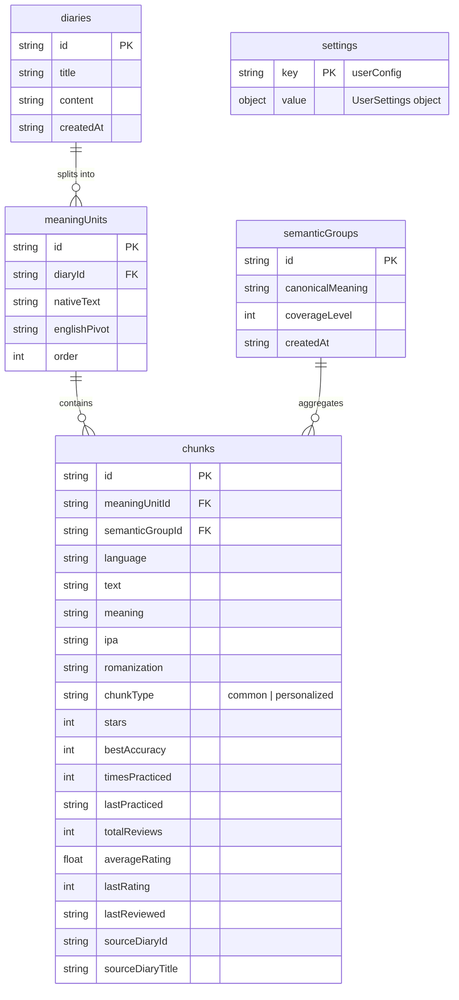

# ChunkDiary - System Architecture

Welcome to the technical architecture documentation for **ChunkDiary**, a modern web application designed for natural language acquisition through chunk-based writing, recording, and pronunciation practice.

---

## 1. System Overview & Tech Stack

ChunkDiary is built as a local-first single-page application (SPA). The current
beta still uses Google Apps Script for AI generation. Supabase Free tier is the
cloud migration target: Supabase Edge Functions for optional AI requests,
Supabase Auth for guest/account identity, and Postgres tables for opt-in sync.
The legacy Express backend remains useful for local development and fallback
experimentation.

*   **Frontend Framework**: React 19, TypeScript (v5.8), Vite (v6), and TailwindCSS (v4).
*   **Animations & Icons**: Motion (Framer Motion replacement) for page transitions, Lucide React for UI iconography.
*   **Local Database**: Client-side **IndexedDB** remains the source of truth for diaries, generated chunks, progress, semantic groups, and onboarding profile.
*   **Cloud Backend Target**: **Supabase** (migration in progress).
    *   Supabase Edge Function `generate-chunks` will run alongside Google Apps Script before becoming the default.
    *   Supabase Auth anonymous users provide a technical backend identity for users who have completed the local profile gate.
    *   Linked accounts (Google/email later) keep the same user identity so users can restore data on another device.
    *   Supabase Postgres stores cloud profile backup, progress restore payloads, and generated chunk corpus for future bot improvement.
*   **Legacy Local Backend**: Node.js Express server (`server.ts`) written in TypeScript, compiled with `esbuild`.
    *   Acts as a dev server with Vite middleware in local environment.
    *   Keeps a local `/api/generate-chunks` development path while backend adapters are being unified.
*   **Speech Services**: Uses standard Web APIs built into modern browsers:
    *   **Speech Recognition**: `webkitSpeechRecognition` / `SpeechRecognition` API.
    *   **Text-to-Speech (TTS)**: `window.speechSynthesis`.

---

## 2. Directory Structure

```
chunk-diary/
├── assets/                  # Public asset files
├── dist/                    # Production bundle outputs
├── public/                  # Static assets (favicons, manifests, etc.)
├── server.ts                # Express backend server (sequentially-handled LLM proxy & dev setup)
├── index.html               # Main SPA Entry Point
├── package.json             # Build configurations & node dependencies
├── vite.config.ts           # Vite compile parameters
└── src/
    ├── App.tsx              # Root React component, router, layout & permissions coordinator
    ├── index.css            # Custom CSS system, themes, and global Tailwind setup
    ├── main.tsx             # Entry point bootstrapping the React virtual DOM
    ├── types.ts             # Domain-specific TypeScript declarations (Diary, Chunk, UserSettings, etc.)
    ├── components/          # Reusable React components & views
    │   ├── HomeView.tsx           # Dashboard view featuring stats, streaks & quick actions
    │   ├── MyDiaryView.tsx         # List and details of written diaries
    │   ├── MyChunksView.tsx        # Chunk list, filtering, and study library
    │   ├── PracticeGameView.tsx    # Pronunciation game loop
    │   ├── SettingsView.tsx        # User profile, language selections, and API key management
    │   ├── MicPermissionModal.tsx  # Modal handling microphone access issues
    │   ├── profile/
    │   │   └── UserProfileSetup.tsx # Onboarding form for first-time setup
    │   └── story_chat/             # Self-contained voice-first guided conversational wizard
    │       ├── components/         # Sub-components (DraftReview, Header, SummaryView, VoiceInput, etc.)
    │       ├── db/                 # Local persistence for chat sessions (storySessionDb.ts)
    │       ├── hooks/              # Reusable hooks (useIdleTimer, useVoiceRecorder)
    │       ├── models/             # Local types (types.ts)
    │       ├── servises/           # Story lifecycle service layers (storyService.ts)
    │       └── workflow/           # State machine logic & chatbot prompt templates (chatbotWorkflow.ts)
    ├── db/                  # Core client-side database logic
    │   ├── indexedDb.ts            # IndexedDB manager, store definitions, CRUD actions
    │   └── userDb.ts               # Sub-helpers for user settings persistence
    └── utils/               # Shared utilities
        ├── aiService.ts            # AI adapter entry point (Apps Script/Supabase transition)
        ├── browser.ts              # Browser runtime detection helpers
        ├── speech.ts               # Pronunciation scoring and speech recognition setup
        └── tts.ts                  # SpeechSynthesis (text-to-speech) wrappers
```

---

## 3. Data Model

### 3.1 IndexedDB Local Schema

The database utilizes client-side **IndexedDB** with local-first object stores:



*   **`diaries`**: Stores user-written stories or diary entries.
*   **`meaningUnits`**: Stores sentences/ideas extracted from diaries. Acts as the intermediate link.
*   **`chunks`**: Extracted linguistic chunks (collocations, words, phrases) mapping to a specific meaning unit, complete with review history, stars, and pronunciation scores.
*   **`semanticGroups`**: Classifies related chunks across different diaries into canonical meanings to build a personal semantic vocabulary library.
*   **`settings`**: Key-value pair configuration for mandatory local onboarding data, preferred native and target languages, CEFR level, target hobbies/professions, and future account-link status.
*   **`englishChunks`**: Local central bank of English pivot chunks used for deduplication, domain packaging, and future curated datasets.
*   **`userProgress`**: Local restore payload for target chunks and practice stats. This is synced to cloud when Supabase is configured.

### 3.2 Supabase Cloud Schema

Defined in `supabase/migrations/202607270001_cloud_sync.sql`.

*   **`user_settings`**: One JSON profile/settings document per Supabase `auth.users.id`.
*   **`user_progress`**: Per-user restore records for target chunks and practice statistics.
*   **`sync_snapshots`**: Reserved for coarse full-device backup snapshots.
*   **`generated_chunk_corpus`**: Corpus table for chunks users generate. This supports product analytics, chunk quality review, and future bot improvement/training workflows.

Security model:

*   Row Level Security is enabled on all user data tables.
*   Users can read/write only rows where `user_id = auth.uid()`.
*   Anonymous Supabase users are allowed so beta users can sync data before linking a permanent account.
*   When a user later links Google/email, the same Supabase user identity should continue owning the already-synced data.

---

## 4. AI & Chunk Generation Pipelines

To process a diary, the application joins the user's story sentences, sends the result to an authenticated backend, translates semantic units, and extracts phonetic chunks.

### Pipeline A: Google Apps Script (Current Beta Production)

Google Apps Script remains the current production AI backend for the small web
beta. Its legacy request/response shape must be wrapped by the canonical AI
adapter described in `docs/ai/api-contract.md`.

### Pipeline B: Supabase Edge Function (Migration Target)

The migration should resolve the backend through an adapter/feature flag rather
than coupling React components to one endpoint. The intended order during the
transition is:

1. The configured beta backend, currently Google Apps Script.
2. Supabase Edge Function for internal or opted-in users.
3. A local mock/development adapter for tests.

The Supabase function lives at `supabase/functions/generate-chunks/index.ts`.

*   **Auth Gate**: The frontend requires local `settings.onboarded` before generating chunks. When Supabase is configured, it creates/uses an anonymous Supabase session and sends `Authorization: Bearer <access_token>`.
*   **Backend Gate**: Supabase `config.toml` has `verify_jwt = true`, and the function also rejects missing bearer tokens.
*   **Secret Handling**: `GEMINI_API_KEY` is stored as a Supabase Edge Function secret, never in frontend code.
*   **Response Contract**: New backends should return the canonical object response
    documented in `docs/ai/api-contract.md`. A temporary adapter may parse the
    legacy JSON-string response during migration.

### Pipeline C: Local Express/Mock Development Backend

The Express server and mock adapter are development tools. They must implement the
same canonical contract and must not silently use a different request shape.

*   Useful for local experiments and custom provider fallback.
*   Should not be the long-term production path for the beta cloud backend.

Google Apps Script will remain available until Supabase generation, fallback,
cloud sync, and account linking have passed beta release gates. See
`docs/ai/implementation-plan.md` for the staged migration plan.

---

## 5. Pronunciation Evaluation Engine

The evaluation module (`src/utils/speech.ts`) compares the spoken text recognized by the Web Speech API with the target chunk text. It uses different heuristics based on language characteristics:

1.  **Space-Separated Languages (English, French, Spanish, Vietnamese, etc.)**:
    *   Splits sentences into words.
    *   Calculates similarity using **Levenshtein Distance** for each word.
    *   Matches spoken words with target words, marking each as `"good"` ($\ge 80\%$), `"improve"` ($50\% - 79\%$), or `"wrong"` ($< 50\%$).
2.  **Logographic/Character-Based Languages (Chinese, Japanese)**:
    *   Splits sentences into characters.
    *   Performs character-by-character validation to account for missing space separators.
3.  **Accuracy-to-Star Mapping**:
    *   Calculates a weighted average between individual word scores ($70\%$) and overall string similarity ($30\%$) to penalize skipped words.
    *   Maps score to stars: **5 Stars** ($\ge 95\%$), **4 Stars** ($80\% - 94\%$), **3 Stars** ($60\% - 79\%$), **2 Stars** ($40\% - 59\%$), and **1 Star** ($< 40\%$).

---

## 6. Story Chat Module (`src/components/story_chat`)

The **Story Chat** module replaces traditional diary writing with a voice-guided workflow. 

### Core Design Philosophy
*   **Zero LLM Conversational Cost**: The chatbot (named *Sky*) is **completely offline and non-generative**. It uses predefined prompts and scripts instead of an interactive LLM to guide users. This keeps cost at zero and ensures predictable conversational flow.
*   **Strict Voice-First Validation**: It promotes speech by providing recording interfaces, enforcing a draft-review phase (where speech recognition outputs are displayed for modification or deletion *before* sending), and running idle timeout timers (reminds user at 30 seconds, prompts pause/stop at 60 seconds).
*   **Separation of Concerns**: The module is strictly sandboxed in its subdirectory, calling only shared utility services like IndexedDB, TTS, and the AI Service when completing a story.

### Workflow Diagram

```
[Start Session]
       │
       ▼
[Greet User (Offline Script)]
       │
       ▼
[Wait for User Speech / Text Input]
  ├── (Idle 30s) ──► Show Gentle Reminder
  └── (Idle 60s) ──► Prompt Session Pause
       │
       ▼
[Draft Review (Voice Mode Only)]
  ├── Edit ──────► Keyboard Mode
  ├── Delete ────► Reset back to Voice Mode
  └── Send ──────► Append to Conversation Timeline
       │
       ▼
[Complete Story Command] (User triggers "Tạo chunks" / click button)
       │
       ▼
[Summary View] (User can delete/edit sentence order, but cannot add/reorder)
       │
       ▼
[AI Chunk Extraction] ──► Parse & write to IndexedDB ──► [Go to Chunks Library]
```


---

## 7. Current Backend Migration Plan

### Product Rules

*   The user must create a local learner profile before using the app.
*   The profile defines the learning domain: native language, target language, CEFR, learning purpose, specialty, and sub-specialty.
*   This profile is not optional because ChunkDiary is designed for immediately usable communication chunks, not generic vocabulary drills.
*   Anonymous Supabase identity is acceptable for beta sync and corpus collection.
*   Account linking later should preserve the same synced data so users can change devices and restore progress.
*   Web beta monetization is not a priority. AdSense is not attractive for this product. AdMob is deferred until a Capacitor/native mobile app phase.

### Target Architecture

```
React/Vite SPA
  | local-first reads/writes
  v
IndexedDB
  | AI request requires local profile
  v
Supabase Auth anonymous session
  | bearer token
  v
Supabase Edge Function generate-chunks
  | GEMINI_API_KEY secret
  v
Gemini API

After generation:
  IndexedDB chunks/progress
  Supabase user_progress
  Supabase generated_chunk_corpus
```

### Implementation Task List

Done:

*   Removed the hardcoded Google Apps Script endpoint from `src/utils/aiService.ts`.
*   Added Supabase endpoint resolution via `VITE_SUPABASE_URL` / `VITE_GENERATE_CHUNKS_ENDPOINT`.
*   Added `@supabase/supabase-js` dependency.
*   Added `src/services/supabase/client.ts` with anonymous session creation and future link helpers.
*   Added `src/services/supabase/cloudSync.ts` for profile, progress, restore, and generated chunk corpus sync.
*   Updated `src/services/storage/cloudSyncAdapter.ts` to call real Supabase sync helpers.
*   Updated onboarding (`UserProfileSetup.tsx`) to create a Supabase anonymous session and sync profile after local profile creation when Supabase is configured.
*   Updated story chunk generation (`StoryChatView.tsx`) to sync generated chunks to corpus and sync progress after local save.
*   Added Supabase Edge Function at `supabase/functions/generate-chunks/index.ts`.
*   Added Supabase migration at `supabase/migrations/202607270001_cloud_sync.sql`.
*   Added RLS policies for user-owned cloud data.
*   Added `generated_chunk_corpus` table for future bot improvement/training datasets.
*   Added `src/vite-env.d.ts` for Vite env typing.
*   Updated `.env.example` with Supabase env vars.
*   Updated `tsconfig.json` to exclude Supabase Deno functions from root app typecheck.
*   Verified `npm run lint` passes.

Pending:

*   Create or select the Supabase project.
*   Enable Supabase Auth anonymous sign-ins in the Dashboard.
*   Enable manual identity linking in Supabase Auth settings.
*   Apply `202607270001_cloud_sync.sql` in Supabase SQL Editor or via Supabase CLI.
*   Set Supabase Edge Function secrets: `GEMINI_API_KEY` and optionally `GEMINI_MODEL`.
*   Deploy `generate-chunks` Edge Function.
*   Create local `.env` with `VITE_SUPABASE_URL` and `VITE_SUPABASE_PUBLISHABLE_KEY`.
*   Test first-run onboarding with Supabase configured.
*   Test chunk generation against deployed Supabase function.
*   Verify rows are inserted into `user_settings`, `user_progress`, and `generated_chunk_corpus`.
*   Add Settings UI for cloud status: guest synced, link Google/email, restore progress, manual sync.
*   Add privacy/consent copy explaining generated chunks may be synced and used to improve the learning bot.
*   Decide whether diaries/raw stories should sync. Current implementation syncs chunks/progress, not full diary text as a dedicated cloud table.
*   Decide deploy host for web beta: Cloudflare Pages/Workers static hosting is still preferred for free beta hosting; Supabase handles backend/data.
*   Plan Capacitor/native phase for better TTS/STT, persistent mic UX, Firebase Analytics/AdMob later.

### Next Start Here

1. Open Supabase Dashboard and create/select a project for ChunkDiary.
2. In Auth settings, enable anonymous sign-ins and manual linking.
3. Run the SQL in `supabase/migrations/202607270001_cloud_sync.sql`.
4. Add Edge Function secret `GEMINI_API_KEY`.
5. Deploy `supabase/functions/generate-chunks`.
6. Fill `.env` from `.env.example`.
7. Run `npm run lint`, then start the app and test the full path:
   local onboarding -> anonymous session -> chunk generation -> local save -> cloud corpus/progress sync.

### Known Local Issue

`npm run build` previously failed on this Windows workspace because `node_modules/esbuild/bin/esbuild` was a Linux ELF binary. `npm run lint` passes. If a production build is needed, reinstall dependencies cleanly on Windows or delete `node_modules` and run `npm install` from a normal PowerShell before building.
