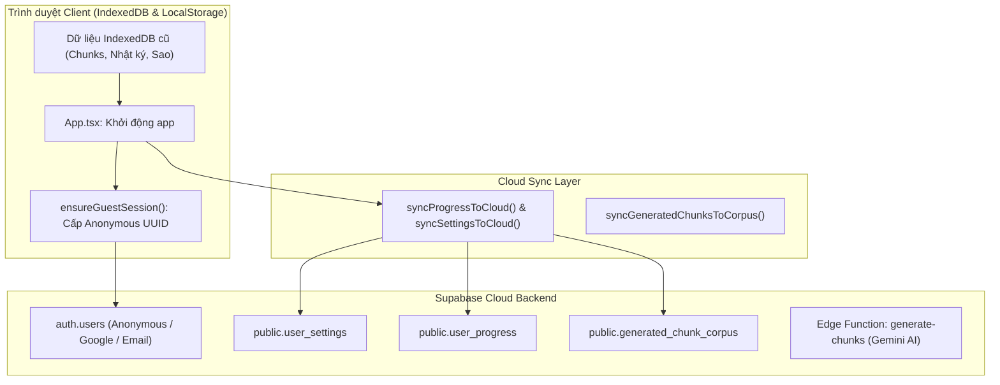

> **LƯU Ý — KẾ HOẠCH LỊCH SỬ / KHÔNG THỰC THI (2026-10-10)**
> Tài liệu này được giữ làm tham khảo lịch sử và có nhiều chỉ dẫn **đã bị thay thế** (ví dụ tự động gom dữ liệu ghost user, nhánh `feat/supabase-vercel`, hay quy trình beta trung gian).
> **Source of truth hiện tại:** [APP_DEVELOPMENT_PLAN.md v1.3](./APP_DEVELOPMENT_PLAN.md) và [thiết kế direct cutover](./migration/BETA_TRANSITION_DESIGN.md).
> Phát triển **chỉ trên `codex/supabase-app`**; giữ `main` nguyên đến khi hoàn thiện, kiểm thử và được phê duyệt thay thế production. Không tự upload nhật ký local hoặc gán ownership cho tài khoản khi chưa có consent.

# KẾ HOẠCH TRIỂN KHAI (IMPLEMENTATION PLAN)
## Chuyển đổi sang Vercel & Supabase Backend (Bảo toàn Dữ liệu User & Ghost User)

Tài liệu này ghi lại toàn bộ lộ trình, kiến trúc kỹ thuật và các bước thực thi để tiếp tục công việc trong các phiên làm việc tiếp theo mà không bị gián đoạn hay quên ngữ cảnh.

---

## 1. MỤC TIÊU VÀ YÊU CẦU CỐT LÕI
1. **Chuyển đổi hạ tầng Frontend**: Chuyển từ **GitHub Pages** sang **Vercel Deployment**.
2. **Chuyển đổi hạ tầng Backend**: Chuyển từ **Google Apps Script** sang **Supabase** (Postgres DB + Auth + Deno Edge Functions).
3. **Bảo toàn 100% dữ liệu người dùng cũ**:
   - Dữ liệu học tập (IndexedDB: `diaries`, `chunks`, `meaningUnits`, `userProgress`) trên thiết bị người dùng không bị mất, không bị vô hiệu hóa, không bắt học lại từ đầu.
   - Hỗ trợ cả **Ghost User (Người dùng ẩn danh)**: Tự động gom dữ liệu lên Supabase qua Anonymous Session UUID ngay khi họ mở lại ứng dụng.
   - Khi họ liên kết tài khoản Google / Email, Supabase sẽ giữ nguyên UUID và nâng cấp tài khoản mượt mà.
4. **Quy trình triển khai an toàn**: Kiểm thử trên nhánh Git mới (`feat/supabase-vercel`) kết nối Vercel Preview trước khi merge vào `main`.

---

## 2. KIẾN TRÚC ĐỒNG BỘ DỮ LIỆU (DATA FLOW)



---

## 3. LỘ TRÌNH THỰC HIỆN TỪNG BƯỚC (STEP-BY-STEP CHECKLIST)

### Bước 1: Chuẩn bị Backend Supabase
- [ ] **1.1. Tạo Supabase Project**: Tạo project mới trên [supabase.com](https://supabase.com).
- [ ] **1.2. Chạy SQL Migration**:
  - Mở Supabase SQL Editor.
  - Chạy toàn bộ file `supabase/migrations/202607270001_cloud_sync.sql` để tạo các bảng `user_settings`, `user_progress`, `generated_chunk_corpus`, `sync_snapshots` kèm chính sách Row Level Security (RLS).
- [ ] **1.3. Bật Anonymous Sign-In & Auth Providers**:
  - Supabase Dashboard -> **Authentication** -> **Providers** -> Bật **Anonymous Sign-Ins**.
  - Bật thêm **Google** / **Email** nếu muốn hỗ trợ đăng nhập chính thức.
- [ ] **1.4. Deploy Supabase Edge Function**:
  - Deploy function trong thư mục `supabase/functions/generate-chunks/` lên Supabase.
  - Cấu hình Secret `GEMINI_API_KEY` trong Supabase Dashboard -> Edge Functions -> Secrets.

---

### Bước 2: Hoàn thiện Codebase Local (Auto-Sync & Backup UI)
- [ ] **2.1. Cấu hình Auto-Sync khi mở app (`src/App.tsx`)**:
  - Trong hàm `initializeApp()`, kích hoạt chạy ngầm `cloudSync.syncUserProgress()` và `cloudSync.syncUserProfile()` để bất cứ ai mở app đều được tự động backup lên Cloud theo Guest UUID.
- [ ] **2.2. Thêm giao diện Quản lý Tài khoản & Sao lưu (`src/components/SettingsView.tsx`)**:
  - Hiển thị trạng thái tài khoản: *Guest Ẩn danh (Đã lưu cloud)* hoặc *Tài khoản Google/Email*.
  - Nút **"Liên kết Google"** / **"Liên kết Email"** (`linkGuestWithGoogle`).
  - Nút **"Xuất file JSON sao lưu"** (`exportLocalDiariesBackup`) và **"Nhập file JSON sao lưu"** làm phương án dự phòng thủ công.

---

### Bước 3: Tạo Nhánh Mới & Deploy Thử Nghiệm Trên Vercel
- [ ] **3.1. Tạo và push nhánh Git mới**:
  ```bash
  git checkout -b feat/supabase-vercel
  git add .
  git commit -m "feat: integrate Supabase cloud sync, auth, and prepare Vercel deployment"
  git push -u origin feat/supabase-vercel
  ```
- [ ] **3.2. Cấu hình Project trên Vercel**:
  - Đăng nhập [vercel.com](https://vercel.com) -> **Add New Project** -> Chọn repo `chunk-diary`.
  - Chọn nhánh deploy: `feat/supabase-vercel`.
  - Thiết lập **Environment Variables**:
    - `VITE_SUPABASE_URL` = `https://<your-project>.supabase.co`
    - `VITE_SUPABASE_PUBLISHABLE_KEY` (hoặc `VITE_SUPABASE_ANON_KEY`) = `<your-anon-key>`
- [ ] **3.3. Kiểm thử trên Domain Vercel**:
  - Test tạo nhật ký mới & bóc tách Chunks qua AI Edge Function.
  - Test luyện phát âm & kiểm tra cập nhật điểm sao.
  - Kiểm tra bảng `user_progress` trên Supabase xem dữ liệu có xuất hiện đúng không.

---

### Bước 4: Thu gom Dữ liệu User Cũ trên GitHub Pages & Hoàn tất Chuyển giao
- [ ] **4.1. Merge nhánh vào `main`**:
  - Sau khi test trên Vercel thành công 100%, tạo Pull Request và Merge `feat/supabase-vercel` vào `main`.
  - GitHub Pages tự động deploy bản code mới này.
- [ ] **4.2. Giai đoạn Thu gom Dữ liệu (Transition)**:
  - Khi user cũ truy cập lại web GitHub Pages, hệ thống tự động đẩy dữ liệu cũ từ IndexedDB lên Supabase.
  - Đặt thông báo / banner hướng dẫn người dùng chuyển sang địa chỉ web mới trên Vercel.
- [ ] **4.3. Đóng GitHub Pages & Private Repo**:
  - Sau thời gian chuyển tiếp (ví dụ 1-2 tuần hoặc khi đã gom đủ dữ liệu), tắt GitHub Pages trong **GitHub Settings -> Pages**.
  - Chuyển Repository sang **Private**. Vercel vẫn tự động build và deploy từ Private Repo bình thường.

---

## 4. BẢNG TRA CỨU FILE QUAN TRỌNG TRONG CODEBASE

| File | Chức năng |
| :--- | :--- |
| [`src/services/supabase/client.ts`](file:///d:/00%20Other%20Works/Vibecode/chunk-diary/src/services/supabase/client.ts) | Khởi tạo Supabase client, xử lý Guest Session, Link Google/Email |
| [`src/services/supabase/cloudSync.ts`](file:///d:/00%20Other%20Works/Vibecode/chunk-diary/src/services/supabase/cloudSync.ts) | Đẩy/kéo tiến độ học (`user_progress`), cài đặt (`user_settings`), corpus chunks |
| [`src/services/storage/cloudSyncAdapter.ts`](file:///d:/00%20Other%20Works/Vibecode/chunk-diary/src/services/storage/cloudSyncAdapter.ts) | Adapter trung gian giữa UI và Supabase |
| [`src/services/storage/localOnlyStorage.ts`](file:///d:/00%20Other%20Works/Vibecode/chunk-diary/src/services/storage/localOnlyStorage.ts) | Quản lý nhật ký nội bộ & hàm Export/Import JSON sao lưu |
| [`src/db/indexedDb.ts`](file:///d:/00%20Other%20Works/Vibecode/chunk-diary/src/db/indexedDb.ts) | Cấu trúc cơ sở dữ liệu client IndexedDB (`LanguageChunkDiaryDB`) |
| [`supabase/migrations/202607270001_cloud_sync.sql`](file:///d:/00%20Other%20Works/Vibecode/chunk-diary/supabase/migrations/202607270001_cloud_sync.sql) | Script SQL tạo bảng và RLS policies trên Supabase |
| [`supabase/functions/generate-chunks/`](file:///d:/00%20Other%20Works/Vibecode/chunk-diary/supabase/functions/generate-chunks) | Edge Function AI bóc tách chunks thay thế Apps Script |
